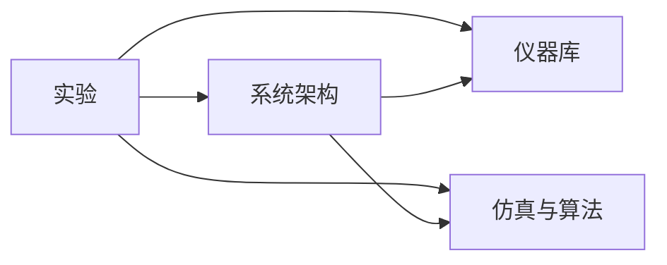

# FMCW-Lidar

FMCW 激光雷达工作区。主仓库保留公开入口，只保存统一入口、依赖关系与子模块版本；主体代码、实验数据和内部手册按职责分到四个私有子仓库。

## 四个子仓库

| 目录 / 仓库 | 职责 | 不应放入的内容 |
|---|---|---|
| [FMCWLidar-SIL](FMCWLidar-SIL) | **仪器与器件库**：SIGLENT TCP 驱动、可拖放器件模块、器件行为模型、参数面板、六份本地手册 | 整机控制算法、逐次实验结果 |
| [FMCWLidar-matlab-sim](FMCWLidar-matlab-sim) | **仿真与可复用算法**：原 MATLAB 信号级仿真、FPGA 控制器软件参考、算法 Simulink 库 | 实机连接、采集数据、完整 Vivado 工程 |
| [FMCWLidar-Experiments](FMCWLidar-Experiments) | **实验记录**：每次模块联调、辨识、验证、历史数据和报告、实验运行脚本 | 冒充已完成系统的实验方案 |
| [FMCWLidar-Architecture](FMCWLidar-Architecture) | **整体架构与集成**：已存在的软件集成模型、系统参数、完整 FPGA/Vivado 工程、UDP 上位机 | 单次实验结果、重复的仪器驱动 |

前两个仓库保留原名和提交历史；`FMCWLidar-SIL` 现在专管仪器/器件，不再承载整机仿真入口。

依赖方向：



仪器库、仿真库可独立使用；系统架构依赖这两个库；实验按需组合它们。新增功能先放入所属仓库，不把四类文件重新堆回主仓库。

## 一次下载、统一打开

账号必须有**主仓库和四个私有子仓库**的访问权限。已有主仓库权限不等于自动拥有所有子仓库权限。

```sh
git clone --recurse-submodules git@github.com:SZTU-ICOC-FMCWlab/FMCW-Lidar.git
```

已有克隆：

```sh
git submodule update --init --recursive
```

在 MATLAB 中进入**主仓库根目录**，运行：

```matlab
open_fmcw_workspace
```

这会初始化四个仓库，打开器件库、算法库和系统架构图；**不仿真、不连接信号发生器、不改变仪器输出**。缺少保存的模型时会先构建模型。

其他入口：

```matlab
roots = startup_fmcw_workspace(); % 只设置路径；不依赖启动 MATLAB 时所在的目录
paths = build_fmcw_workspace();   % 重新生成/更新模型；不运行它们
```
已打开的模型/库只更新内存，不会替你保存已有修改；需要保留构建更新时，请自行保存。仓库随附的模型已完成本次回调迁移并保存。


如果旧版本同名模型仍在 MATLAB 中打开，请先自行保存并关闭旧窗口，避免从两个目录加载同名模型。入口不会强制关闭或丢弃已有窗口中的修改。

需要 MATLAB 和 Simulink；信号仿真的额外工具箱、Python/Vivado 依赖分别见对应子仓库 README。PDF 用系统默认阅读器打开。

**GitHub 的 Download ZIP 不包含子模块内容。** 不使用 Git 时，需分别下载主仓库及四个子仓库，按上表目录名解压到同一工作区，才能使用统一入口。

## 器件、帮助与安全

- 在器件库中双击模块打开参数面板，点击“帮助”打开本地手册或接口说明。
- 六份器件 PDF 随私有仪器仓库提供，仅供内部阅览；不依赖原电脑的手册目录，也不代表获得公开再分发许可。
- SIGLENT 模块是**真实 TCP 仪器控制**，不是电压波形仿真源；默认禁用硬件。使用前核对 IP、实际型号、接线、负载、幅度和被驱动器件安全范围。
- 不要为查看模型而开启硬件。软件停止关断不是安全互锁；旧归档中的 TCP/USB 脚本可能重置仪器并开启输出，不能作为无副作用的连通性检查。

[设备规格与保护边界](FMCWLidar-SIL/docs/DEVICE_GUIDE.md) · [设备接口](FMCWLidar-SIL/docs/DEVICE_INTERFACES.md) · [本地手册](FMCWLidar-SIL/docs/manuals/README.md)

## 实验与系统完成度

- [逐次实验和历史数据索引](FMCWLidar-Experiments/README.md)
- [SIGLENT ARB 实机验证记录](FMCWLidar-Experiments/runs/2026-10-22-siglent-arb/README.md)
- [200 kHz / 3 GHz / 0.50 m MZI 辨识与补偿方案](FMCWLidar-Experiments/docs/TX_LINEARIZATION_200KHZ.md)
- [离线 HTML 实验方案](FMCWLidar-Experiments/docs/TX_Identification_Compensation.html)
- [既有 SIL 验证基线和缺口](FMCWLidar-Experiments/docs/SIL_STATUS.md)
- [系统集成入口和 FPGA 工程](FMCWLidar-Architecture/README.md)

**已存在的集成代码不等于已完成硬件验证。** 新目标的辨识/ILC/CMA-ES 文档是实验设计，不能当作已实现的端到端闭环。当前整机软件模型默认 200 MS/s 采样、50 us 单边、0.50 m MZI、64 chirp；200 MS/s 不是 200 kHz 三角波重复频率。历史确定性仿真和波形存储回读不能替代真实激光链路、FPGA 或示波器测量。

## 迁移核验

- 已在 MATLAB/Simulink 中构建四类模型并打开库、架构图及 SIGLENT 面板；仪器库含八个器件块，不再包含 FPGA 控制器。
- 六份本地手册路径解析通过；SIGLENT 硬件禁用示例运行通过，原用户模型的模块、参数和连线坐标保持不变。
- ARB 历史波形重建为 2000 字节、10 个 LF 字节，SHA256 匹配记录；本次没有连接仪器或改变实机输出。
- 整机软件模型运行两 chirp：器件范围检查通过、无 FPGA fault。不是 64 chirp 收敛验证，也不是实机精度验证。
- 另建全新本地递归克隆，统一打开入口、实际器件 OpenFcn、随仓库 PDF 和硬件禁用示例均通过；该检查不替代 GitHub 远端权限与网络克隆验证。
- 旧信号级仿真仍需要 Symbolic Math Toolbox；本机没有 `syms`，该完整入口烟测在标定求解处停止，不能记为通过。
- 活动文档的本地链接检查通过；Vivado 工程源文件引用可在本地文件或对应 XCIX 容器中定位。未执行 Vivado 综合或硬件验证。
- [完整离线联调记录及未通过项](FMCWLidar-Experiments/runs/2026-10-22-repository-migration/README.md)

## 迁移记录

2026-10-22：由两个混合职责仓库拆分为四个职责仓库；主仓库增加统一初始化、构建和打开入口。原有两仓库历史保留；历史报告/数据和用户修改的 SIGLENT 模型原件移入实验仓库归档。具体文件归属、运行入口与验证边界见各子仓库 README。
